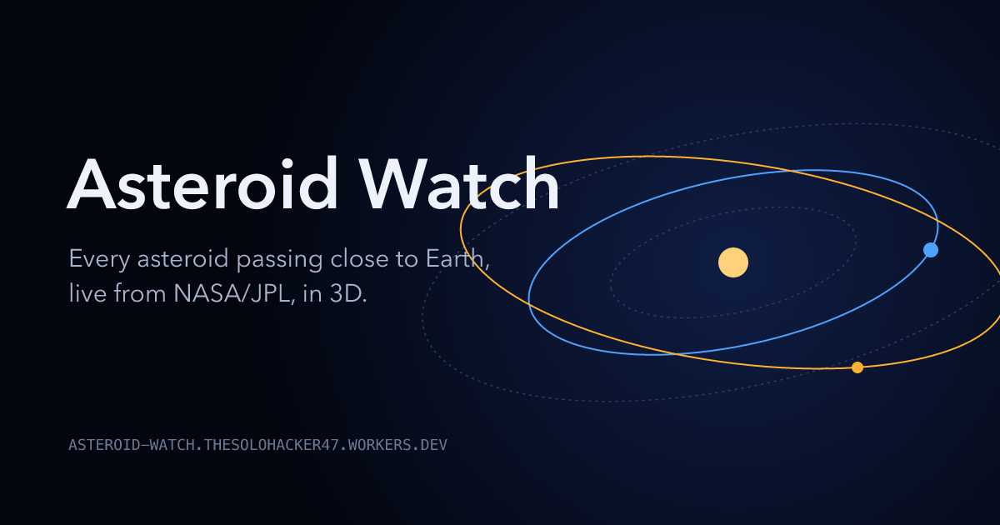

# Asteroid Watch

A live 3D tracker of every asteroid passing close to Earth, built on NASA/JPL open data.

**Live:** https://asteroid-watch.thesolohacker47.workers.dev



- **A live solar system (Three.js).** Every upcoming asteroid moves on its real orbit around the Sun. Drag the bottom timeline, or press play, to move through time.
- **The timeline is the chart.** Each close approach is a tick: taller means closer, and red means it passes inside the Moon's distance.
- **Pick an asteroid** (in the scene, on the timeline or in the list). The camera frames its orbit, and the panel shows its closest distance, speed, orbit, and its size drawn to scale next to something familiar (a car, a bus, the Qutub Minar, the Eiffel Tower).
- **Watch the flyby.** An Earth-centred view of the 6 days around the approach, with JPL Horizons positions, the real Moon, a sunlit Earth and a live distance readout.
- **Long-term watch list** of the 10 objects highest on the Palermo impact-hazard scale (NASA Sentry).
- Shareable links (`?days=30&ld=5&sel=2025+UK9`), keyboard support, reduced-motion support, and a phone layout.

## Run it

Needs Node 18 or newer. `npm start` has no runtime dependencies, so there's nothing to install first.

```bash
npm start
```

Then open http://localhost:5173. Run the tests with `npm test`.

## Deploy

It runs on Cloudflare Workers: `src/worker.js` handles `/api/*`, and Workers Static Assets serves `public/`.

```bash
npm install
npm run deploy
```

Use `npm start` for local development, not `npm run dev`. JPL's servers use an Entrust TLS certificate, and the local Workers runtime (`wrangler dev`) doesn't trust it, so API calls fail there. Deployed Workers on Cloudflare's network reach JPL fine.

## How it works

```
browser ──> server.js (local) or src/worker.js (Cloudflare)
                      ──> ssd-api.jpl.nasa.gov/cad.api      (close approaches)
        cached 10 min ──> ssd-api.jpl.nasa.gov/sentry.api   (impact risk)
                      ──> ssd-api.jpl.nasa.gov/sbdb.api     (orbital elements)
                      ──> ssd.jpl.nasa.gov/api/horizons.api (flyby positions)
```

- JPL's APIs don't send CORS headers, so the browser can't call them directly. A small proxy forwards only allow-listed endpoints and validated parameters (`src/routes.js`, shared by the Node server and the Worker), and caches each response for 10 minutes so it doesn't hammer JPL.
- `public/neo.js` holds the pure logic (unit conversion, size estimates, comparisons, summaries) and is unit-tested in `test/`.
- `public/orbit.js` solves Kepler's equation to turn orbital elements into positions. It's tested against Earth's known position and against JPL's distance for a real flyby.
- `public/scene.js` is the Three.js scene: the solar system, the flyby view, camera flights, and hover/click picking in screen space so small dots are easy to hit.
- `public/timeline.js` is the time scrubber; `public/app.js` ties data, scene, panels and URL state together.
- No build step: ES modules in the browser, with Three.js and lottie-web from CDNs.

## Design and assets

The design direction and its rationale (a reference lock plus a decision ledger, researched with Refero) are in [`docs/design.md`](docs/design.md).

Assets are made with open-source tools and can be rebuilt from scripts:

- **VectorCraft** (vector illustration) draws the logo, the asteroid rock, the to-scale size silhouettes, the scene's glow sprites and the social image: `VECTORCRAFT_CLI=… python3 tools/build_vector_assets.py`. Editable sources go to `design/vector/`.
- **EffectCraft** (motion graphics) animates the loader and the "closer than the Moon" pulse, exported as Lottie: `EFFECTCRAFT_CLI=… sh tools/build_motion_assets.sh`. Project files go to `design/motion/`.

## The science, briefly

- **Lunar distance (LD)**: 384,400 km, the average Earth–Moon distance. 1 AU ≈ 389 LD.
- **Size from brightness**: most asteroids have never been measured. Their size comes from absolute magnitude *H* and an assumed reflectivity (albedo): `D(km) = 1329 / √albedo × 10^(−H/5)`. The tracker shows a range from bright (albedo 0.25) to dark (0.05), and uses JPL's measured diameter when there is one.
- **Two models, on purpose**: the solar-system view uses a two-body model (Sun plus asteroid). That's exact enough for the orbit's shape, but it ignores Earth's pull. For 2025 UK9 it puts the closest approach at 0.84 LD, about 4.5 hours early, against JPL's 0.82 LD. The flyby view instead uses JPL Horizons, which includes every planet's and the Moon's pull, so its numbers match JPL's.
- **Palermo scale**: compares an asteroid's impact risk to the normal background risk. Below −2 means no likely consequences. Between −2 and 0 means it deserves careful monitoring.

## Data

- [JPL SBDB Close-Approach Data API](https://ssd-api.jpl.nasa.gov/doc/cad.html)
- [JPL Sentry API](https://ssd-api.jpl.nasa.gov/doc/sentry.html)
- [JPL SBDB API](https://ssd-api.jpl.nasa.gov/doc/sbdb.html) and [JPL Horizons API](https://ssd-api.jpl.nasa.gov/doc/horizons.html)
- Planet positions: Standish, *Keplerian Elements for Approximate Positions of the Major Planets* (JPL)

This isn't an official NASA product.

## Ideas for next steps

- Send a daily alert when something comes closer than the Moon.
